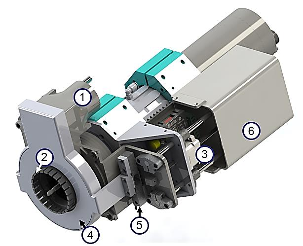
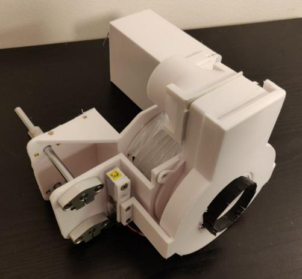
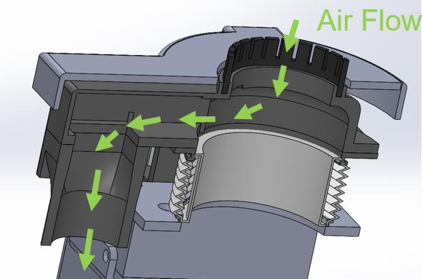
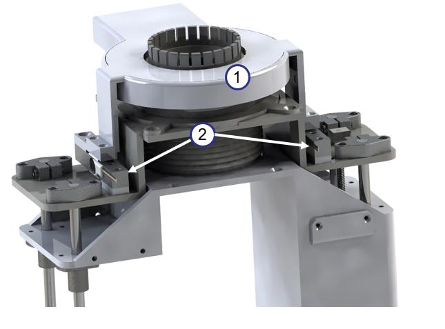
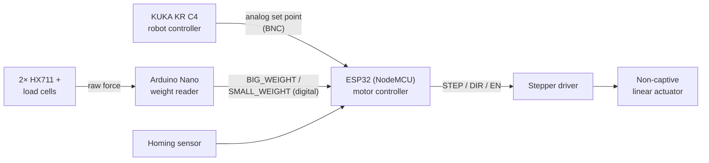
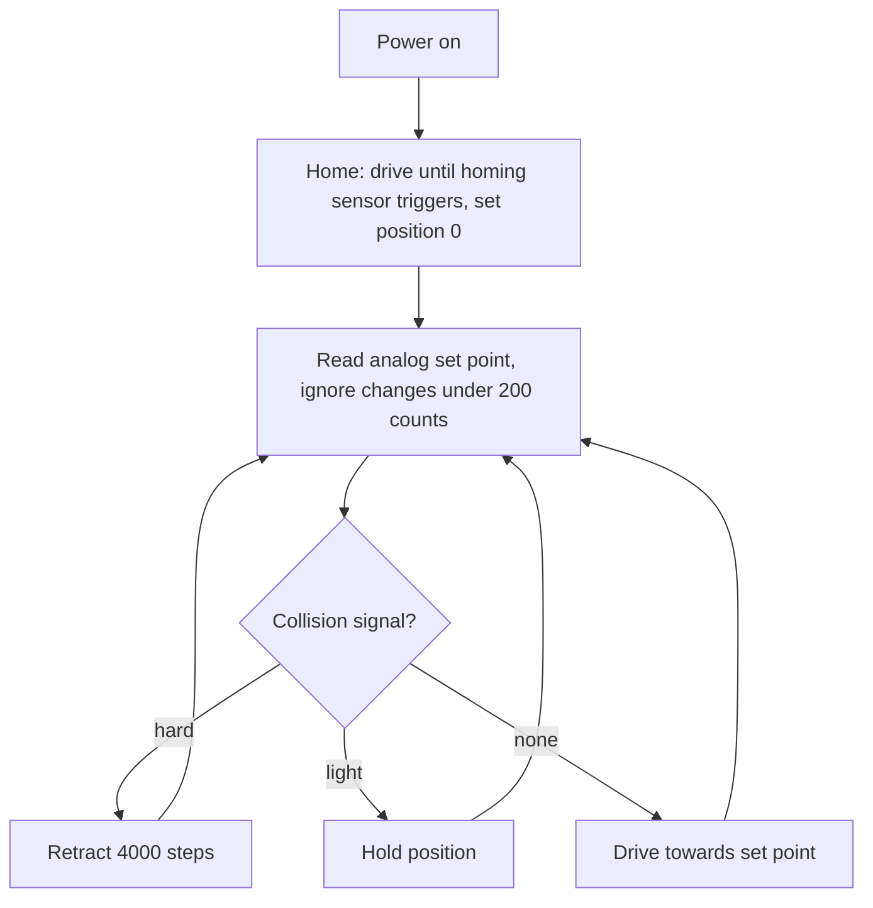
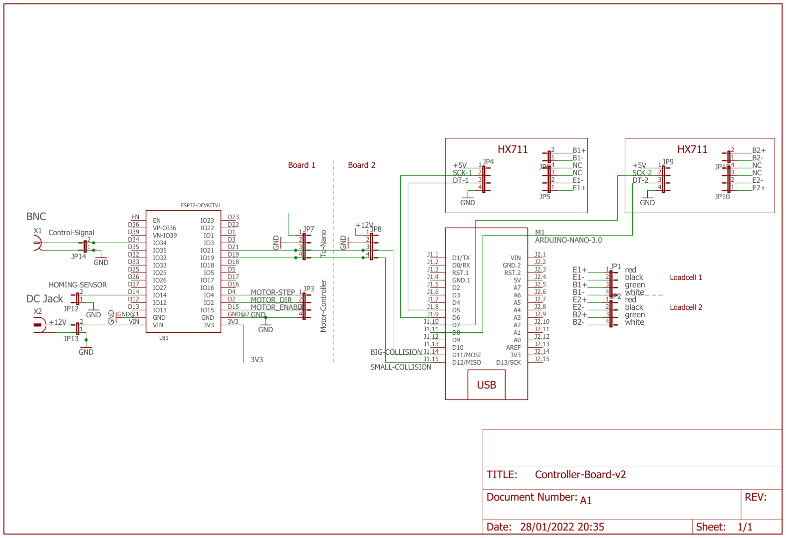
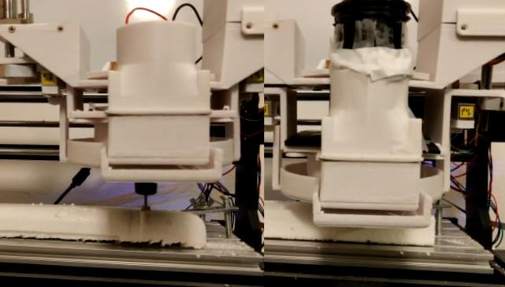
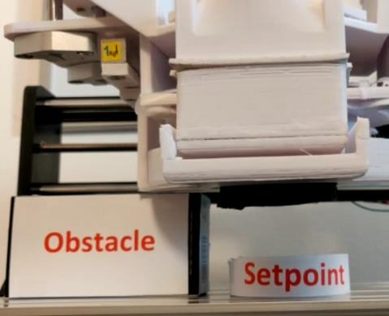

# MMR3 – Autonomous Dust Extractor for a Robot Milling Station

A motorised, collision-aware dust and chip extractor for robot machining cells. The suction inlet sits on a linear actuator and moves along the spindle axis: the robot controller sets the inlet position with an analog signal that matches the length of the tool in use, and a load-cell collision protector makes the inlet stop or retract when it hits something.
Built for the KUKA KR 16 milling station in the Digital Factory at UAS Technikum Wien, as a solo master's project (Mechatronics/Robotics, 3rd semester, 2021/22).

<p align="center">
  
  
</p>

<sub>Left: 1 exhaust tube inlet, 2 flexible brush, 3 non-captive linear actuator, 4 collision protector, 5 load cell, 6 electronics lid. Right: the printed prototype.</sub>

<p align="center">
  
  
</p>

<sub>Left: air flows from the brush-lined inlet to the hose connector. Right: the collision shield (1) mounted on two load cells (2).</sub>

---

## The problem

A robot arm can mill large or oddly shaped parts without a machine table, but the dust goes everywhere. A fixed hose has to stay far from the tool so the robot does not hit it, which means high suction power and big chips are left behind. A hood or enclosure costs even more energy. Bringing the inlet close to the cutter requires it to:

- stay out of the way of the **automatic tool changer** (only ~44 mm of clearance at the collet),
- adapt to **tools of different lengths**,
- avoid **collisions** with the workpiece and fixtures that the robot program does not know about,
- be controllable **from the robot program** itself.

## Highlights

- **Variable-length inlet:** a Nanotec non-captive stepper linear actuator (lead screw through the rotor) moves the inlet on four linear shafts. It holds its position without a brake when powered off.
- **Set point from the robot:** the KUKA KR C4 sets the inlet position with an analog output (BNC input). The ESP32 maps it to 5 000 – 28 000 steps.
- **Collision protector:** a shield mounted on two strain-gauge load cells (HX711 amplifiers). An Arduino Nano classifies the force into *none / light / hard* and signals the ESP32. On light contact the inlet holds its position. On hard contact it retracts 4 000 steps.
- **Automatic homing** on start-up with an end-stop sensor.
- **Fully 3D-printed body** (PLA, ~900 g) with threaded inserts. About €200 in materials.

## System architecture



### Control loop (ESP32)



## Hardware

### Electronics

Two perfboards connected by pin headers: board 1 holds the ESP32 DevKit V1 (stepper control, BNC set-point input, 12 V DC jack, homing sensor). Board 2 holds the Arduino Nano and two HX711 load-cell amplifiers.

<p align="center">
  
</p>

| Signal | ESP32 pin | Notes |
|---|---|---|
| MOTOR_STEP / DIR / ENABLE | GPIO 4 / 2 / 15 | to stepper driver |
| Analog set point | GPIO 34 (ADC) | from KR C4 via BNC |
| BIG_WEIGHT / SMALL_WEIGHT | GPIO 21 / 19 | from Nano D12 / D11 |
| Homing sensor | GPIO 26 in firmware | the schematic routes it to IO14. Check your wiring. |

Eagle sources and a PDF export are in [`hardware/`](hardware).

## Firmware

| Sketch | Board | Role |
|---|---|---|
| [`firmware/motor_controller_esp32`](firmware/motor_controller_esp32) | ESP32 | homing, set-point tracking, collision reaction (AccelStepper) |
| [`firmware/weight_reader_nano`](firmware/weight_reader_nano) | Arduino Nano | reads both load cells (HX711, gain 32, 10-sample average), outputs light/hard collision flags |

**Dependencies** (install with the Arduino Library Manager, not vendored here):
- [HX711](https://github.com/bogde/HX711) by Bogdan Necula (MIT)
- [AccelStepper](https://www.airspayce.com/mikem/arduino/AccelStepper/) by Mike McCauley

**Tuning:**
- Collision thresholds in `weight_reader_nano.ino`: `SMALL_WEIGHT_THRESHOLD` / `BIG_WEIGHT_THRESHOLD` (raw HX711 counts, 40 000 / 100 000 in the final firmware). Higher values make the inlet tolerate more pressure before it reacts. Recalibrate if the protector adapter bends.
- Travel range in `motor_controller_esp32.ino`: `map(analogSignal, 0, 4095, 5000, 28000)`.

## Build & run

1. Print the parts in [`cad/`](cad) (SolidWorks parts + assembly; STL files are included for the sensor parts). Mount the rails, actuator and driver with M3 threaded inserts. Press 3 mm strip brushes (or rubber strips) into the inlet channel.
2. Wire the boards following the schematic.
3. Flash `weight_reader_nano` to the Nano and `motor_controller_esp32` to the ESP32.
4. Supply 12 V (max. 1 A) to the DC jack, and connect the robot's analog output to the BNC jack.
5. On power-up the extractor homes, then follows the analog set point.

> ⚠️ ESP32 GPIOs are 3.3 V. Keep the analog set point within 0 – 3.3 V (the original manual says 5 V), and level-shift the Nano's 5 V collision outputs, for example with a voltage divider.

The full assembly and commissioning guide (German) is in [`docs/user-manual-de.pdf`](docs/user-manual-de.pdf).

## Results

<p align="center">
  
  
</p>

From the [project paper](docs/paper-dust-extractor.pdf):
- Mounted on a cartesian CNC milling Styrofoam, the extractor collected **both fine dust and large chips with only a 200 W vacuum cleaner**, because the inlet sits right next to the cutter.
- The two-threshold collision scheme worked: the inlet **stops before its set point when it meets an obstacle** and retracts on a hard hit.
- Lessons learned: the printed moving inlet flexes slightly (the side away from the lead screw lags behind). Stiffer ribs or carbon-fibre filament would fix this. The L-shaped load-cell adapter should be made from metal. The load cells only sense vertical contact, so mounting them at 45° would also catch side hits.
- Next step: validate on the KUKA KR 16 itself (the tests so far used a CNC).

## Repository layout

```
firmware/   ESP32 motor controller + Arduino Nano load-cell reader
hardware/   Eagle schematic/board (Controller-Board-v2) + PDF export
cad/        SolidWorks parts & assembly of the self-designed components, STL for sensor parts
docs/       project paper (EN) and user manual (DE)
media/      GIFs and images used in this README
```

The CAD folder contains only the parts I designed. Purchased components (Nanotec linear actuator, stepper driver, linear bearings and shaft supports, load cell, connectors, push button, screws/inserts) are left out. The assembly will show them as missing references; you can get them from the manufacturers' sites.

## My contribution

Solo project: concept, mechanical design in SolidWorks, 3D printing and assembly, electronics and wiring, firmware for both microcontrollers, testing, the paper, the user manual and the presentation. Supervised by Martin Kainrath at UAS Technikum Wien.
